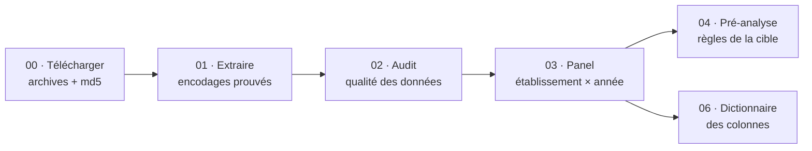

<div align="center">

# Décrochage d'activité MCO

**Prévoir, un an à l'avance, qu'un établissement de santé va nettement perdre de l'activité en médecine, chirurgie et obstétrique.**

[](https://www.python.org/)
[](tests/)
[](LICENSE)
[](https://www.etalab.gouv.fr/licence-ouverte-open-licence/)

Projet de machine learning · M2, UE « ML & IA fiable » · Ousmane SOUMAH et Adrien LAUZE

</div>

---

## Sommaire

- [La question](#la-question)
- [La cible](#la-cible)
- [Les données](#les-données)
- [Démarrage rapide](#démarrage-rapide)
- [La chaîne de traitement](#la-chaîne-de-traitement)
- [Organisation du dépôt](#organisation-du-dépôt)
- [Documentation](#documentation)
- [Avancement](#avancement)
- [Licence](#licence)

## La question

Chaque année, certains établissements voient leur activité MCO chuter bien plus vite que celle du reste de la France. Le projet cherche à **repérer ces établissements un an avant**, à partir de ce qu'ils déclarent dans la *Statistique annuelle des établissements de santé* (SAE).

## La cible

Pour chaque établissement et chaque année *t*, on regarde s'il **décroche** en *t+1* :

| Règle | Choix |
|---|---|
| **Activité** | journées d'hospitalisation complète + 0,5 × (venues de partielle + séjours de 0 jour), en journées-équivalentes |
| **Établissements étudiés** | au moins 1 000 journées-équivalentes en *t* |
| **Référence** | évolution de l'activité MCO de toute la France, pondérée par l'activité |
| **Décrochage** | évolution de l'établissement inférieure à la référence − 15 points |
| **Sortie** | établissement absent ou sans activité en *t+1* : compte comme un décrochage |
| **Restructuration probable** | baisse retrouvée ailleurs dans le groupe, ou fusion / scission déclarée : repérée et mise à part |

> [!NOTE]
> Chaque règle est justifiée, chiffres à l'appui, dans [`docs/decisions.md`](docs/decisions.md). Les valeurs se règlent dans [`config.yaml`](config.yaml), sans toucher au code.

## Les données

| | |
|---|---|
| **Source** | DREES, *Statistique annuelle des établissements de santé* (SAE), bases statistiques |
| **Période** | 2013 à 2025 |
| **Tables utilisées** | ID, MCO, MCOPED, MCOGER, MCOAVC, URGENCES, SSR (SMR en 2025) |
| **Licence** | Licence Ouverte v2.0 (Etalab) |

> [!IMPORTANT]
> Les données ne sont **pas** dans le dépôt. Leurs adresses et leurs empreintes md5 sont dans [`donnees/sources_donnees_brutes.csv`](donnees/sources_donnees_brutes.csv) : le premier script les télécharge et vérifie chaque archive.

## Démarrage rapide

```bash
git clone https://github.com/ousmane-soumah01/sae-decrochage-mco.git
cd sae-decrochage-mco
python -m pip install -r requirements.txt
```

Puis, depuis la racine du dépôt, dans l'ordre :

```bash
python scripts/00_telecharger.py     # télécharge les 13 archives (~290 Mo) et vérifie leur md5
python scripts/01_extraire.py        # extrait les tables utiles, prouve l'encodage de chaque fichier
python scripts/02_audit_qualite.py   # audit : colonnes, manquants, types, clés, cohérence
python scripts/03_panel.py           # panel : une ligne par établissement et par année
python scripts/04_preanalyse.py      # pré-analyse des règles de la cible
python scripts/06_dictionnaire.py    # dictionnaire des colonnes du panel
python -m pytest                     # tests unitaires et d'intégration
```

Chaque script dit, en tête de fichier, ce qu'il lit et ce qu'il produit.

## La chaîne de traitement



## Organisation du dépôt

```text
sae-decrochage-mco/
├── config.yaml          paramètres du projet (années, seuils, règles de la cible)
├── donnees/             liste des sources ; brutes/, extraites/, preparees/ non versionnés
├── src/                 fonctions réutilisables : chargement, qualité, nettoyage, panel, activité, cible
├── scripts/             étapes numérotées, à lancer dans l'ordre
├── tests/
│   ├── unitaires/       une fonction à la fois
│   └── integration/     la chaîne de bout en bout
├── resultats/           tableaux et figures produits par les scripts, rangés par étape
└── docs/                décisions, nettoyage, dictionnaire
```

## Documentation

| Document | Contenu |
|---|---|
| [`docs/decisions.md`](docs/decisions.md) | chaque choix de méthode, sa justification, et des définitions en phrases simples (FINESS, entité juridique, fusion, scission…) |
| [`docs/nettoyage_donnees.md`](docs/nettoyage_donnees.md) | résultats de l'audit et règles de nettoyage appliquées |
| [`docs/dictionnaire.md`](docs/dictionnaire.md) | chaque colonne du panel : définition DREES, unité, source, règle, cases vides |

## Avancement

- [x] Données : téléchargement, extraction, encodages, audit de qualité
- [x] Panel : nettoyage, identité, région actuelle, indicateurs
- [x] Règles de la cible, avec leur pré-analyse
- [x] Dictionnaire des colonnes du panel
- [ ] Table de modélisation, modèles, évaluation
- [ ] Application et rapport

## Licence

Code sous licence [MIT](LICENSE). Données : DREES, Licence Ouverte v2.0 (Etalab).
